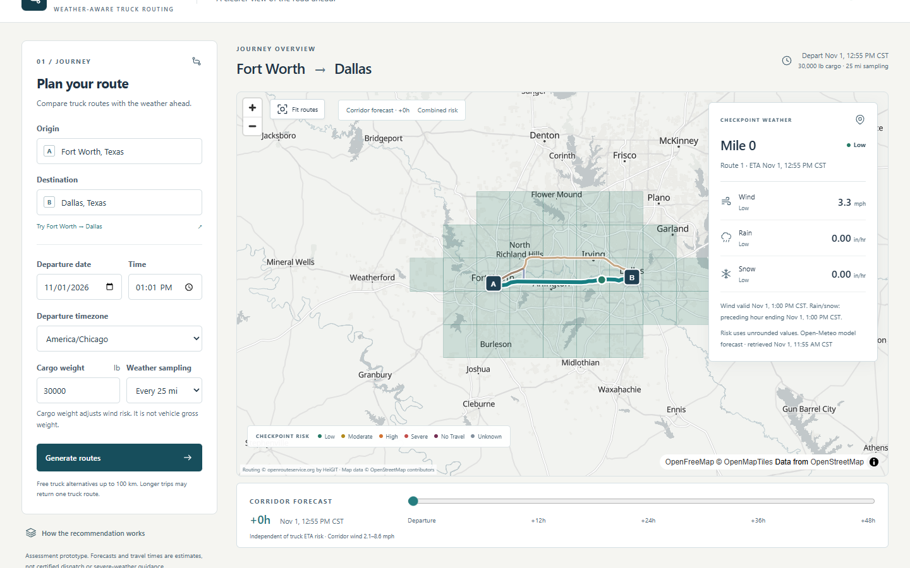

<div align="center">

# 🚛 Routecast

### Weather-aware truck routing, evaluated where the truck will actually be

Compare genuine truck-route alternatives using the forecast at each checkpoint's **estimated arrival time**, not the weather right now.

[](https://spotter-weather-routing-jm1n.onrender.com/)


**[🌐 Live application](https://spotter-weather-routing-jm1n.onrender.com/)** · **[🎥 Loom walkthrough](https://www.loom.com/share/4a1e612e342d42c49437a2e5b26c9be0)** · **[📚 Technical docs](docs/README.md)** · **[🏗 Architecture](docs/ARCHITECTURE.md)** · **[🧮 Methodology](docs/METHODOLOGY.md)**



<sub>Local application rendering captured provider responses with real basemap tiles. This is replay evidence, not a fresh hosted forecast. See <a href="docs/PRE_LOOM_QA.md">capture details</a>.</sub>

</div>

---

## Table of contents

- [Live demo](#live-demo)
- [Features](#features)
- [How it works](#how-it-works)
- [Risk rules](#risk-rules)
- [Architecture](#architecture)
- [Tech stack](#tech-stack)
- [Getting started](#getting-started)
- [Configuration](#configuration)
- [Testing and quality](#testing-and-quality)
- [Deployment](#deployment)
- [Limitations](#limitations)
- [Documentation](#documentation)
- [Data providers and attribution](#data-providers-and-attribution)

## Live demo

| | |
|---|---|
| **Application** | https://spotter-weather-routing-jm1n.onrender.com/ |
| **Loom walkthrough** | https://www.loom.com/share/4a1e612e342d42c49437a2e5b26c9be0 |
| **Hosting** | Render (free tier) — static frontend plus Python web service |

> **Note:** free-tier services sleep when idle. The first request after a quiet period can take up to a minute while the backend wakes. Provider quotas also apply, so heavy use can return honest error states.

## Features

- **Genuine truck routing.** OpenRouteService `driving-hgv` alternatives with official distance, duration and instruction timing. If fewer alternatives exist, that is reported rather than manufactured.
- **Road-distance checkpoints** every **10, 25 or 50 miles** along the actual road geometry, never straight-line, with origin and destination always included.
- **Arrival-time weather.** Wind, rain and snowfall are looked up for the moment the truck is expected at each checkpoint.
- **Cargo-sensitive risk.** The assessment's load-weight wind overrides are applied exactly as specified.
- **Explained recommendation.** Routes are ranked by Severe miles, High miles, distance-weighted average risk, then travel time. No Travel disqualifies a route.
- **Honest about missing data.** Missing weather is *unknown*, never silently treated as Low risk. Forecast provenance, retrieval time, valid time and coverage are preserved.
- **Corridor forecast scrubber.** 49 preloaded frames, from departure through +48 hours. Scrubbing changes the corridor map without changing the ETA-based recommendation.
- **Accessible by design.** Semantic HTML, keyboard-operable route and checkpoint lists as a map alternative, visible units and timezones, and reduced-motion support.

## How it works

1. **Plan.** The user enters origin, destination, departure time (with explicit timezone), cargo weight and checkpoint spacing.
2. **Route.** Django asks OpenRouteService for truck alternatives. Official step distances and times are distributed along the road geometry and reconciled to the provider totals.
3. **Sample.** Checkpoints are placed at exact road-distance intervals. Each ETA is the departure time plus cumulative travel time.
4. **Forecast.** Open-Meteo hourly data is matched to each ETA: wind uses the nearest hour within 30 minutes; rain and snowfall use the preceding-hour accumulation containing the ETA. Units are normalized to mph and inches per hour.
5. **Classify.** The worst applicable hazard (after cargo overrides) sets each checkpoint's risk. Each road interval takes the worse of its two endpoints.
6. **Rank.** Complete, eligible routes are compared lexicographically. Incomplete evidence makes a recommendation provisional or unavailable.

The full rules, boundary interpretations and conservative choices are in [METHODOLOGY.md](docs/METHODOLOGY.md) and [DECISIONS.md](docs/DECISIONS.md).

## Risk rules

| Hazard | Low | Moderate | High | Severe | No Travel |
|---|---|---|---|---|---|
| Wind (mph) | < 25 | 25 – < 35 | 35 – < 45 | 45 – < 55 | ≥ 55 |
| Rain (in/hr) | < 0.10 | 0.10 – < 0.25 | 0.25 – < 0.50 | 0.50 – 1.00 | > 1.00 |
| Snow (in/hr) | < 0.5 | 0.5 – < 1.0 | 1.0 – < 2.0 | 2.0 – 3.0 | > 3.0 |

**Cargo overrides** (strict inequalities; equality does not trigger):

- Cargo **> 30,000 lb** with wind 45 – < 55 mph → **No Travel**
- Cargo **> 40,000 lb** with wind 35 – < 45 mph → **Severe**

## Architecture

```text
React planner ──► Django API ──► OpenRouteService (truck routes, Pelias geocoding)
                     │
                     ├──► checkpoints + ETAs ──► Open-Meteo ──► risk ──► ranking
                     │
React forecast slider ◄── bounded corridor forecast ◄── Open-Meteo
```

- **Adapters are isolated.** ORS, Pelias and Open-Meteo live in `backend/routing/providers/`. Optional HERE support remains but needs no credentials.
- **Domain logic is pure.** Sampling, risk, exposure and ranking in `backend/routing/domain/` make no network calls and are tested independently of providers.
- **Secrets stay on Django.** Provider keys never reach the browser.
- **No database, queue or accounts.** Stateless by design.

```text
backend/    Django + DRF API (providers/, domain/, services/, api/, tests/)
frontend/   React + TypeScript + Vite client (features/, api/, components/)
docs/       Specification traceability, methodology, decisions, audits, evidence
scripts/    Environment initializer, secret scanner, production smoke check
render.yaml Render blueprint (manual deploys; auto-deploy and previews off)
```

## Tech stack

| Layer | Technology |
|---|---|
| Frontend | React 19, TypeScript, Vite, Tailwind CSS, Zod contracts |
| Map | MapLibre GL JS with OpenFreeMap tiles |
| Backend | Django 5.2, Django REST Framework, Gunicorn |
| Routing / geocoding | OpenRouteService `driving-hgv`, HeiGIT Pelias |
| Weather | Open-Meteo |
| Tooling | uv, pytest, Ruff, ESLint, Prettier, Vitest, Playwright, axe-core |

## Getting started

**Prerequisites:** Python 3.13, [uv](https://docs.astral.sh/uv/), Node 24 with npm, and a free [OpenRouteService API key](https://openrouteservice.org/).

From the repository root:

```powershell
python scripts/init_env.py
cd backend
uv sync --locked
# Set ORS_API_KEY in the git-ignored backend/.env
uv run --env-file .env python manage.py runserver 127.0.0.1:8000
```

The initializer preserves existing values and generates a local Django secret without printing it. In a second terminal:

```powershell
cd frontend
npm ci
npm run dev
```

Open http://127.0.0.1:5173. Vite proxies `/api` to Django, and no migrations are needed. The Fort Worth → Dallas example fills the form; generating routes calls the real providers.

## Configuration

| Variable | Purpose |
|---|---|
| `ORS_API_KEY` | Backend secret, supplied via ignored `.env` or hosting environment |
| `ROUTING_PROVIDER` | `ors` by default; optional HERE adapter remains available |
| `ORS_BASE_URL` | `https://api.heigit.org/openrouteservice` |
| `ORS_GEOCODING_BASE_URL` | `https://api.heigit.org/pelias/v1` |
| `DJANGO_DEBUG` | `true` locally; `false` in production |
| `DJANGO_SECRET_KEY` | Stable backend secret for signed corridor context |
| `DJANGO_ALLOWED_HOSTS` | Allowed hosts; Render adds its supplied hostname |
| `CORS_ALLOWED_ORIGINS` | Exact frontend origins; blank for the local Vite proxy |
| `VITE_API_BASE_URL` | Public API URL; defaults to `/api/v1` locally |

See the placeholder-only [backend](backend/.env.example) and [frontend](frontend/.env.example) templates. Provider credentials never belong in Vite variables, and `.env` files are never committed.

## Testing and quality

Routine tests make **no provider calls**. They use controlled fixtures that are visibly labelled as fixtures; they are never presented as live observations. Coverage includes threshold boundaries, unit conversion, distance/time conservation, unknown weather and route ordering.

From `backend/`:

```powershell
uv run --env-file .env pytest
uv run ruff check . ../scripts
uv run ruff format --check . ../scripts
uv run --env-file .env python manage.py check
uv lock --check --offline
uv run python ../scripts/check_secrets.py --assets ../frontend/dist
```

From `frontend/` (build before the asset scan above):

```powershell
npm run lint
npm run format:check
npm run typecheck
npm test
npm run build
npx playwright install chromium
npm run test:e2e
npm audit --omit=dev
```

See the [testing guide](docs/TESTING.md) for deterministic fixtures, Linux Gunicorn checks and opt-in provider verification.

## Deployment

Routecast runs on Render as a Python web service (API) and a static site (UI). [render.yaml](render.yaml) declares the blueprint with free backend compute, auto-deploy off and previews off, so a GitHub push does **not** redeploy. Build and start commands, secrets, CORS and manual release steps are in [docs/DEPLOYMENT.md](docs/DEPLOYMENT.md).

## Limitations

This is an assessment prototype, **not** certified truck dispatch or severe-weather navigation software.

- Cargo weight is not gross vehicle weight; physical truck dimensions and legal restrictions are not configured.
- ETAs exclude live traffic, breaks and driver-hours rules. Forecasts and interval exposure are estimates.
- Public alternatives are limited to 100 km and cannot be guaranteed for arbitrary journeys.
- Departure is limited to six days ahead; later arrivals or +48-hour frames can exceed forecast coverage and remain *unknown*.
- Corridor sampling is bounded at 96 cells and signed context at 6,000 coordinates; polar and dateline corridors are rejected.
- WebGL is required for the map; route and checkpoint lists remain usable without it.
- Free services have quotas and cold starts; process-local caches reset on restart.

## Documentation

| Document | Contents |
|---|---|
| [docs/README.md](docs/README.md) | Documentation index |
| [ARCHITECTURE.md](docs/ARCHITECTURE.md) | Module boundaries, data flow, contracts |
| [METHODOLOGY.md](docs/METHODOLOGY.md) | Sampling, forecast selection, risk and ranking |
| [ASSESSMENT.md](docs/ASSESSMENT.md) | Requirement traceability |
| [DECISIONS.md](docs/DECISIONS.md) | Interpretations and provider rationale |
| [TESTING.md](docs/TESTING.md) | Checks, fixtures and live-provider labelling |
| [DEPLOYMENT.md](docs/DEPLOYMENT.md) | Render services and releases |
| [FINAL_AUDIT.md](docs/FINAL_AUDIT.md) | Dated evidence and known limitations |

The original [assessment PDF](docs/fs-assessment-spotter.pdf) is the authoritative specification. The [walkthrough outline](docs/WALKTHROUGH.md) is the script; the [Loom recording](https://www.loom.com/share/4a1e612e342d42c49437a2e5b26c9be0) is the author's own explanation of the project.

## Data providers and attribution

- **Routing and geocoding:** [openrouteservice.org](https://openrouteservice.org/) and Pelias by HeiGIT, using OpenStreetMap data.
- **Forecasts:** [Open-Meteo](https://open-meteo.com/) under CC BY 4.0 and its non-commercial free-service terms.
- **Basemap:** OpenFreeMap, OpenMapTiles and OpenStreetMap contributors. Attribution stays visible in the app.

No project software license has been selected yet. The owner should also confirm permission to redistribute the assessment PDF; its presence in the repository does not establish redistribution rights.
