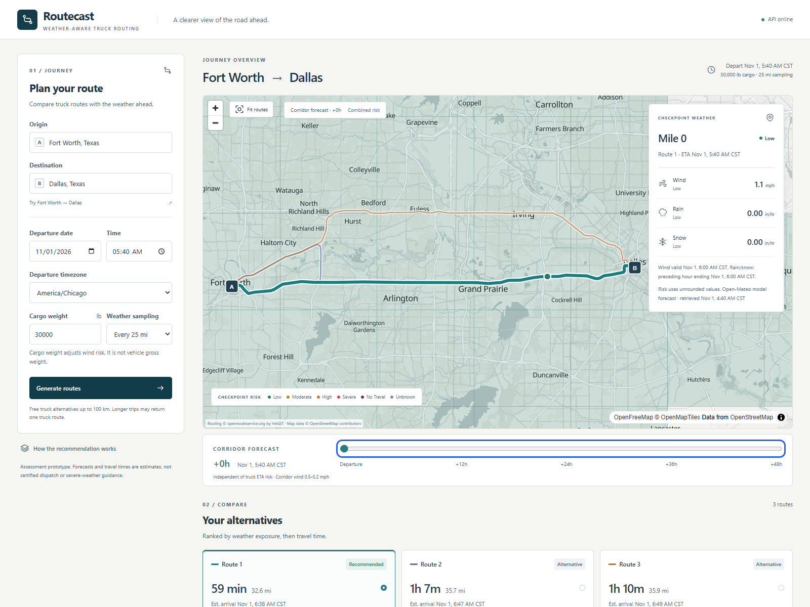

# Routecast: Weather-Aware Truck Routing

A React + Django assessment prototype that compares genuine truck routes using weather expected at road-distance checkpoints. Built for the [Spotter specification](docs/fs-assessment-spotter.pdf), November 1-4, 2026.

**Hosted demo:** pending deployment approval and verification.

**Loom:** not recorded; [7-8 minute outline](docs/WALKTHROUGH.md).

**Repository:** [Weather-Aware-Truck-Routing](https://github.com/UsmanPrime/Weather-Aware-Truck-Routing) | local milestones await push approval.



[Mobile journey](docs/screenshots/mobile.png) | [Mobile forecast controls](docs/screenshots/mobile-forecast.png). These are actual local Chromium captures using live providers, not fixture illustrations. [Timestamped browser evidence](docs/evidence/live-browser.json).

## Features

- OpenRouteService **driving-hgv** alternatives with actual geometry, official distance/duration and instruction-step timing. Three genuine alternatives verified on Fort Worth-Dallas; fewer available alternatives stay explicit.
- Road-distance checkpoints at 10/25/50 miles, including origin/destination once, with estimated arrivals and arrival-aligned Open-Meteo wind/rain/snow forecasts.
- Exact assessment thresholds, strict cargo-load overrides, conservative interval exposure and deterministic lexicographic recommendations. No Travel and missing data are explicit.
- Persistent MapLibre/OpenFreeMap map, synchronized route/checkpoint selection, accessible list alternative, keyboard autocomplete and explicit IANA timezone handling.
- Independent 0-48-hour corridor forecast: 49 preloaded frames, bounded discrete cells, risk/wind/rain/snow views, unknown styling, actual valid times and source/retrieval metadata. Slider updates reuse geometry and do not rerank routes.
- Bounded provider usage, caching, structured failures, input/body/context limits, exact-origin CORS and production server configuration. No database, queue, accounts, paid APIs or hidden browser keys.

## Run locally

Prerequisites: Python 3.13, [uv](https://docs.astral.sh/uv/), Node 24 LTS and npm. PowerShell users can use `npm.cmd` if execution policy blocks `npm`.

From the repository root:

```powershell
python scripts/init_env.py
cd backend
uv sync --locked
# Set ORS_API_KEY in the ignored backend/.env if not already configured.
uv run --env-file .env python manage.py runserver 127.0.0.1:8000
```

The initializer preserves existing credentials and creates a stable local Django secret without printing it. In another terminal:

```powershell
cd frontend
npm ci
npm run dev
```

Open `http://127.0.0.1:5173`; Vite proxies `/api` to Django. No migrations or database installation are required. Use "Try Fort Worth to Dallas" for a verified alternative-routing corridor; it fills inputs only, and generates real data when submitted.

## Environment

| Variable | Location / purpose |
|---|---|
| `ROUTING_PROVIDER=ors` | Backend; default free truck provider. Optional legacy HERE adapter is retained but not needed. |
| `ORS_API_KEY` | Backend secret only, in ignored .env or hosting secret store. |
| `ORS_BASE_URL` | `https://api.heigit.org/openrouteservice` |
| `ORS_GEOCODING_BASE_URL` | `https://api.heigit.org/pelias/v1` |
| `DJANGO_DEBUG` | true locally; false when hosted. |
| `DJANGO_SECRET_KEY` | Stable server secret; mandatory with debug disabled and used for expiring corridor signatures. |
| `DJANGO_ALLOWED_HOSTS` | Comma-separated hosts. Render's supplied hostname is added automatically. |
| `CORS_ALLOWED_ORIGINS` | Exact HTTPS frontend origins when hosted; empty for the local proxy. |
| `VITE_API_BASE_URL` | Public frontend setting; defaults to `/api/v1`. Hosted value is the actual backend HTTPS URL plus `/api/v1`. Never put credentials in Vite variables. |

## Verify

Backend (from `backend`):

```powershell
uv run --env-file .env pytest
uv run --env-file .env python manage.py check
uv run ruff check . ../scripts
uv run ruff format --check . ../scripts
uv run python ../scripts/check_secrets.py
```

Frontend (from `frontend`):

```powershell
npm run lint
npm run format:check
npm run typecheck
npm test
npm run build
npx playwright install chromium
npm run test:e2e
```

Pytest blocks live sockets. Deterministic browser tests explicitly intercept synthetic API data and an empty basemap; they still render actual MapLibre layers and inspect rendered geometry/state. Live-provider checks are separate:

```powershell
# From backend; bounded real requests, never run automatically in CI.
uv run --env-file .env python manage.py provider_smoke --provider ors --output ../docs/evidence/ors-smoke-local.json
uv run --env-file .env python manage.py journey_smoke --output ../docs/evidence/live-plan-local.json
uv run --env-file .env python manage.py corridor_smoke --plan-file ../docs/evidence/live-plan-local.json --output ../docs/evidence/live-corridor-local.json
```

With local servers running, `node scripts/live-browser.mjs` from `frontend` performs an opt-in real browser journey and refreshes screenshots/evidence. It makes actual provider requests; keep runs modest. Verified counts and limitations are in [IMPLEMENTATION](docs/IMPLEMENTATION.md) and the [final requirement audit](docs/FINAL_AUDIT.md). CI is prepared but has not run remotely until code is pushed.

## How decisions are calculated

Provider instructions map geometry indices to distance/time. Each step is reconciled to official section/route totals; checkpoints are interpolated along the road shape. Times are estimates, not live traffic predictions, and exclude driver breaks. Missing instruction timing produces an explicit section-level approximation.

Forecasts use UTC instants. Wind selects the nearest hourly timestamp within 30 minutes, with ties earlier and no extrapolation. Rain plus showers are separate liquid components of the preceding-hour accumulation; snowfall is new snow depth, not water equivalent. All risk calculations use unrounded values.

The worst hazard determines checkpoint risk, after cargo-sensitive wind overrides. Each interval receives the higher endpoint risk; exposure uses its actual road distance. Eligible routes rank by **Severe miles, then High miles, then distance-weighted average risk, then travel time**. The 0-4 index is ordinal, not a probability. No Travel routes are ineligible; incomplete weather and missing alternatives make the result incomplete or provisional. [Exact rules and boundary interpretations](docs/ASSESSMENT.md).

The corridor grid is independent of checkpoint sampling. Frame +0 is departure time and +48 is 48 hours later. Missing cells remain unknown. Map cells do not blend density into a false severity category.

## Architecture and limitations

`backend/routing/providers` normalizes external data; pure `domain` modules handle geometry, forecast lookup, risk, exposure and ranking; `services` coordinates cache/budgets and APIs. React owns presentation/selection, while Django retains all credentials/business decisions. [Architecture](docs/ARCHITECTURE.md) | [decisions](docs/DECISIONS.md) | [assessment traceability](docs/ASSESSMENT.md).

This is an assessment prototype, **not certified real-world truck dispatch or severe-weather navigation**. Cargo weight affects the specified weather rules; physical truck dimensions, tare/gross weight and legal restrictions are not configured. Forecasts and sampled exposure are uncertain. Public ORS alternatives are limited to 100 km; longer trips may yield one truck route. Departure is limited to the next six days; later arrivals/heatmap frames can exceed actual coverage and remain unknown. Corridor sampling is capped at 96 cells, context at 6,000 coordinates, and the corridor layer explicitly rejects polar/antimeridian trips. Rendering needs WebGL; the route/list remains usable when it fails.

Free services have quotas, no SLA and possible cold starts. Cache/budgets are per-process and reset on restart. The current software-renderer samples do not establish the original 50 ms slider target. Remaining development-dependency advisories and hosted-verification gaps are recorded, not concealed.

## Hosting and acknowledgments

[Exact free Render deployment steps](docs/DEPLOYMENT.md) and [render.yaml](render.yaml) are prepared with auto-deploys off. **Do not add a payment method, choose paid resources, push or deploy without approval.** Hosting eligibility, HTTPS/CORS and public performance still need verification after release. Two HSTS scope/preload warnings are intentionally documented pending hostname verification.

Routing: openrouteservice.org by HeiGIT, based on copyright OpenStreetMap contributors. Geocoding: HeiGIT Pelias. Forecasts: [Open-Meteo](https://open-meteo.com/) (CC BY 4.0; free endpoint subject to noncommercial usage terms). Basemap: OpenFreeMap / OpenMapTiles / OpenStreetMap, with attribution retained in the map. Commercial reuse needs a fresh provider-terms review.
