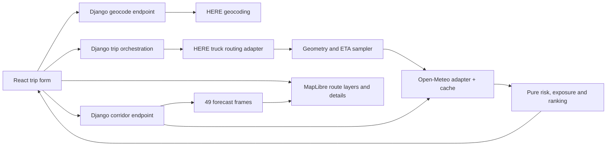

# Architecture and contracts

Approved design with targeted corrections; assumptions are numbered in DECISIONS.md. React and Django are mandatory; remaining stack choices come from the brief. Implementation status and evidence are tracked in IMPLEMENTATION.md.

November 1 approved provider migration: replace HERE in the default data flow with OpenRouteService driving-hgv and HeiGIT Pelias. Keep the same domain/service boundaries and optional HERE adapter. ORS geometry is native GeoJSON; instruction steps provide indexed geometry spans with rounded distance/duration metadata. Checkpoint interpolation reconciles those spans to official section/route totals and is explicitly an estimate without live traffic. Public alternative queries are limited to 100 km; fewer returned alternatives must stay truthful.

## Boundaries and data flow



Frontend owns input, display, map selection and forecast playback. Django owns credentials, validation, normalization, sampling, risk and recommendation. Route planning completes before independent corridor fetch; a heatmap failure cannot discard valid ETA risk results. Provider HTTP never occurs in domain functions. OpenFreeMap tiles are fetched directly by the browser with required attribution. Backend serves no arbitrary provider proxy URLs.

Use REST JSON under `/api/v1`. No persistent trips, user accounts, database models, queue, websocket or Redis required. Same contracts support later persistence without designing for it now. A small process-local TTL cache and signed, short-lived corridor context avoid permanent server state.

## Frontend structure

```text
frontend/src/
  app/                 App, global styles, design tokens
  api/                 client.ts, contracts.ts, structured error parsing
  features/trip/       TripForm, PlaceSearch, DepartureField, LoadField,
                       SamplingControl, useTripPlan
  features/routes/     RouteList, RouteSummary, Recommendation, CheckpointDetails
  features/map/        RouteMap, mapSources, MapLegend, MapFallback
  features/forecast/   ForecastControls, HeatmapLegend, useCorridorForecast
  components/          only repeated primitives (Button, Field, StatusMessage)
```

Use React state and focused hooks; avoid global state libraries initially. Keep map instance in a ref, create sources/layers once, update GeoJSON incrementally. API hooks own cancellation and request generation IDs. Input edits mark previous result as belonging to the previous trip until resubmission; do not mix old geometry with new load labels. Lazy-load MapLibre. Keep selected route and checkpoint IDs as state, not duplicate route objects. Components share selection through a parent. Use CSS tokens for spacing, typography, status colors, focus and responsive layout.

Desktop: trip panel, map, alternative summaries and forecast controls. Mobile: form/summary sheet with accessible map/list switching. All routes remain visible; selected route is emphasized. Status colors have labels and patterns/icons, focus styles and sufficient contrast. Checkpoints may cluster or become visible by zoom, but remain selectable from the list. Popovers show forecast values/units, valid interval, ETA, severity reason and provenance. Retain attribution and provide WebGL failure fallback to route/checkpoint lists.

## Django structure

```text
backend/
  config/              settings.py, urls.py, wsgi.py
  routing/
    api/               views.py, serializers.py, urls.py, errors.py
    domain/            types.py, geometry.py, sampling.py, risk.py, ranking.py
    services/          planning.py, corridor.py
    providers/         here.py, open_meteo.py, http.py
    cache.py
    tests/             domain/, providers/, api/
```

DRF serializers validate untrusted requests. Frozen dataclasses/enums represent normalized provider/domain data. Provider modules validate coordinates, geometry, units, timestamps, durations and notices before returning domain values. Services orchestrate deadlines and partial states. Views map domain/service exceptions to structured API errors without leaking raw provider responses or secrets. Avoid repositories, generic provider frameworks and base classes with one implementation.

## Typed request/response contract

The following TypeScript notation defines the planned wire format; runtime DRF validation is mandatory. JSON numbers must be finite. Timestamps are RFC3339 with offset; responses use UTC `Z`. Geometry coordinates always use GeoJSON `[longitude, latitude]`. Distances use meters internally and wire units explicitly; miles are derived using 1609.344 m/mile. Durations use seconds. IDs are opaque response identifiers, not client-computed hashes.

```ts
type Instant = string; // validated RFC3339; timezone offset required
type Position = [number, number]; // longitude [-180,180], latitude [-90,90]
type Risk = 'low' | 'moderate' | 'high' | 'severe' | 'no_travel';
type Status = 'complete' | 'incomplete' | 'no_travel';
type LineString = { type: 'LineString'; coordinates: Position[] };
interface Place { id: string; label: string; position: Position }
interface PlanRequest {
  origin: Place; destination: Place; departure_at: Instant;
  departure_timezone: string; // validated IANA zone; display semantics
  load_lb: number; checkpoint_interval_mi: 10 | 25 | 50;
}
interface ForecastSample {
  wind_mph: number | null; rain_in_per_hr: number | null;
  snow_in_per_hr: number | null;
  wind_valid_at: Instant | null;
  precipitation_interval_start: Instant | null;
  precipitation_interval_end: Instant | null;
  retrieved_at: Instant; source: 'open_meteo';
  data_kind: 'forecast'; // test fixtures never masquerade as live responses
}
interface Checkpoint {
  id: string; position: Position; distance_from_start_m: number;
  eta: Instant; weather: ForecastSample | null;
  risk: Risk | null; reasons: string[]; missing_fields: string[];
}
interface ExposureSegment {
  from_checkpoint_id: string; to_checkpoint_id: string;
  distance_m: number; risk: Risk | null;
}
interface Route {
  id: string; label: string; geometry: LineString;
  distance_m: number; duration_s: number; arrival_at: Instant;
  checkpoints: Checkpoint[]; segments: ExposureSegment[];
  status: Status; eligible: boolean;
  risk_distance_m: Record<Risk, number>; unknown_distance_m: number;
  average_risk_index: number | null; coverage_fraction: number;
  provider_notices: string[];
}
interface Warning { code: string; message: string; route_id?: string }
interface PlanResponse {
  schema_version: '1'; request_id: string; evaluated_at: Instant;
  routes: Route[]; requested_route_count: 3; actual_route_count: number;
  recommendation: {
    route_id: string | null;
    scope: 'all_candidates' | 'available_candidates' | 'none';
    ordered_eligible_route_ids: string[]; reasons: string[];
  };
  warnings: Warning[];
  corridor_context: string; // signed, uncompressed, bounded geometry + expiry
  forecast_anchor_at: Instant; methodology_version: string;
}
interface CorridorRequest { context: string }
interface CorridorCell { id: number; position: Position }
interface CorridorFrame {
  valid_at: Instant;
  // Arrays align with cells; null indicates unknown, never zero.
  wind_mph: (number | null)[]; rain_in_per_hr: (number | null)[];
  snow_in_per_hr: (number | null)[]; risk: (Risk | null)[];
}
interface CorridorResponse {
  anchor_at: Instant; load_lb: number; corridor_half_width_m: number;
  grid_spacing_m: number; cells: CorridorCell[];
  frames: CorridorFrame[]; // 49 entries, offsets 0..48 inclusive
  retrieved_at: Instant; source: 'open_meteo'; data_kind: 'forecast';
  warnings: Warning[];
}
interface ApiError {
  error: { code: string; message: string; retryable: boolean;
    request_id: string; fields?: Record<string, string[]>;
    retry_after_s?: number };
}
```

Endpoints:

| Endpoint | Success | Validation / failure behavior |
|---|---|---|
| `GET /geocode?q=…` | `{places: Place[]}` | Debounced query, min 3/max 200 chars; empty candidates allowed |
| `POST /plans` | PlanResponse | Coordinates/labels bounded, offset-aware future departure, finite load ≥0, enum interval; 400 invalid input, 422 no route or unsupported limits |
| `POST /corridor-forecasts` | CorridorResponse | Signed context max 128 KiB, expires after 30 minutes; 400 invalid, 410 expired (replan) |
| `GET /health` | `{status:'ok'}` | Process readiness only; no external-provider call |

Provider outage → 503; exhausted upstream deadline → 504; bad provider payload → 502; request throttling → 429 with retry hint. Individual weather gaps can return 200 incomplete plans with warnings, never a false successful complete assessment. Unavailable alternatives return actual count and explicit warning; three-route acceptance still requires a suitable genuine test journey. Validate all response schemas on frontend boundaries with a small explicit parser; choose a schema dependency only if it reduces substantial duplication.

Corridor context carries simplified route geometry, departure, load, schema version and expiry authenticated with Django signing; no secret or provider key inside. It is not encrypted. Start without compression and reject compressed tokens. Enforce 128 KiB encoded input, 96 KiB decoded JSON, at most three routes and 6,000 total coordinates, finite geographic coordinates, bounded departure/load values and 30-minute expiry. If compression is introduced later, enforce the decompressed-size limit during decompression before parsing. No in-memory plan lookup required across workers. Expiry prompts replanning; frontend ignores a stale corridor result after trip/load changes.

## Risk, exposure and recommendation specification

1. Normalize without rounding: mph = km/h ÷ 1.609344; rain in/hr = hourly liquid mm ÷ 25.4; snowfall in/hr = hourly snow cm ÷ 2.54. Validate reported units before conversion. Invalid, negative, NaN or null measurements become unknown with reason, never clamped to zero.
2. Wind severity: `<25 → 0`, `<35 → 1`, `<45 → 2`, `<55 → 3`, otherwise 4. Override `[45,55)` and load >30,000 to 4; override `[35,45)` and load >40,000 to 3.
3. Rain: `<.10 → 0`, `<.25 → 1`, `<.50 → 2`, `≤1.00 → 3`, otherwise 4. Snow: `<.5 → 0`, `<1 → 1`, `<2 → 2`, `≤3 → 3`, otherwise 4. Shared boundary decisions are D03, not explicit PDF resolution.
4. Complete checkpoint severity is maximum of three hazard classes. Retain per-hazard explanations. If required values are missing, risk is null except that a known No Travel condition remains No Travel with missing fields recorded.
5. Between adjacent checkpoints, segment length is their chainage difference; segment severity is the maximum endpoint severity. A known No Travel endpoint makes the segment No Travel even with unknown other endpoint; otherwise unknown endpoint makes segment unknown. Each interval is counted once.
6. Sum segment meters by class plus unknown; sum must equal route distance within stated numerical tolerance (target ≤1 m). Coverage is known assessed distance / total. Complete average index is `Σ(distance_m × ordinal risk) / total_distance_m`; incomplete average is null. No unweighted checkpoint average. Do not round before ordering.
7. Ineligible if any No Travel checkpoint/segment; otherwise incomplete if any required forecast missing, else complete/eligible. No Travel status takes precedence over incomplete but preserve missingness. Rank eligible routes lexicographically by `(severe_m, high_m, average_risk_index, duration_s, provider_order)`; final item is stable tie-breaking only.
8. Explain the first differing ranking criterion. No eligible route → null recommendation and actionable reason. Missing alternatives or incomplete candidates → available-candidates scope and provisional wording. Complete No Travel candidates are excluded with explicit reasons. Do not describe forecast-derived sampled ranking as guaranteed safety.

## Route sampling and ETA

Decode HERE flexible polylines once on backend; concatenate sections without duplicating shared endpoints. Maintain cumulative road geometry chainage and timing spans, not straight-line distance between stops. Insert checkpoints at 0, each requested interval, and total distance. Request dynamicSpeedInfo because length/duration alone do not introduce span boundaries. Inspect live granularity before interpolating time within spans; label any within-span interpolation as an estimate. Preserve summary (including pre/post actions) and travelSummary separately and resolve their timing difference explicitly before ETA implementation. Sum previous sections/spans with documented action-time allocation for absolute departure offsets. Use elapsed seconds rather than local wall-clock arithmetic.

Provider summary length and polyline geodesic length can differ. Build a normalized chainage mapping per section/span, preserving authoritative provider total lengths and durations. Record/validate geometry-to-summary mismatch; day-one spike establishes a tolerance (proposed 5%); large mismatch or absent usable timing fails that route with an explicit warning. Do not label equal-distance constant-speed estimates as provider timing. Reject malformed spans, negative lengths/durations, impossible discontinuities and zero total length. Display ETA as an estimate; no driver rest, weather speed adjustment or hours-of-service model is specified.

## Forecast and heatmap strategy

Fetch hourly series for all checkpoint locations in bounded multi-coordinate batches, deduplicating identical locations across routes. Cache series by provider/model selection, exact requested coordinate, variables, UTC time range and units, never by load; risk is recomputed cheaply for load changes. Request UTC explicitly. Preserve provider-returned grid coordinate and fetch time in adapter diagnostics. Validate batch ordering before associating data with checkpoints. Route assessment checks coverage at checkpoint ETAs only; missing independent heatmap frames/cells are reported explicitly and never invalidate otherwise evaluable routes. Start with bounded batching and record response volume and latency before optimizing corridor density.

Hourly precipitation is accumulated over an interval: normalize upstream semantics to `(start,end]`, select the interval containing ETA; at exact end select the ending interval. Wind uses nearest hourly timestamp (tie chooses earlier), with maximum 30-minute distance and no extrapolation. Never linearly interpolate precipitation peaks. Fetch enough hours on both sides for these rules. Store separate wind valid time and precipitation interval in responses. Confirm exact upstream timestamp semantics in day-one spike. Arrival outside actual coverage becomes unknown.

Build a distance-bounded spatial grid clipped to the union of buffers around every route, not a huge route bounding rectangle. Use local metric projection with explicit high-latitude/dateline handling or reject unsupported geography honestly until handled. Start at 20 km spacing; adapt upward to at most 250 cells. Corridor width and actual density are visible. Request all 49 hourly frames plus required accumulation bounds; batch coordinates, cache data, and classify each cell with the same load rules. Corridor and checkpoint grids have separate purposes; do not substitute a coarse corridor cell for checkpoint weather silently.

Render colored sampled weather cells/points with a restrained density overlay. A severity layer must keep category colors: a generic additive heatmap can make many Low cells look Severe. If using MapLibre heatmap rendering, treat it as a separate intensity visualization with its own legend, not categorical risk. Default categorical corridor raster/cells show no interpolation across missing cells. Offer wind/rain/snow/risk metric selection only after the required risk forecast layer works. Explain that corridor forecasts are model estimates at slider time, while route checkpoint forecasts follow individual ETAs.

Cache fetched forecast series for 15 minutes, routes for 5 minutes keyed by departure and routing inputs, geocoding for 24 hours, subject to provider terms. Do not cache errors as good data or silently serve expired weather. Present retrieval time and coverage. Store no fixtures in production fallback paths.

## Performance, provider failures and deployment

Engineering budgets (targets to measure, not achieved claims): geocode p95 ≤1.5 s, plan p95 ≤8 s warm backend for 3 routes/≤150 unique checkpoints, corridor ≤15 s for ≤250 cells, slider update ≤50 ms and ≥30 fps on a documented reference browser/device. Bound total checkpoints at 600 and reject excessive trips with an explicit coarser-spacing suggestion; never silently change spacing. Record cold-start latency separately. Cap JSON response at 5 MiB and request body at 256 KiB; re-evaluate from measured representative trips.

Initial policy: max 4 upstream requests concurrently per plan, provider batch sizes verified in spike (start at 25 locations), connect timeout 2 s, read timeout 5 s, global plan deadline 12 s, corridor deadline 20 s. Retry idempotent calls once for transient connection/502/503/504 only if deadline allows; honor Retry-After on 429 only within remaining deadline, otherwise return retry hint. No retries for invalid inputs, authorization or malformed payloads. No unbounded work after browser cancellation: finite deadlines cap outstanding server calls. Deduplicate concurrent identical cache requests where practical without introducing a queue.

Geocoding debounce 300 ms, abort obsolete browser requests. Preload/cached 49 compact heatmap frames allow slider scrubbing without network calls; update only the weather source on animation frames. Simplify display geometry only, never analysis geometry. Throttle hover; avoid React render per mouse movement. Abort/ignore stale trip requests. In-process cache has bounded size/TTL; per-worker duplicate misses are an accepted initial limitation. DRF throttles plus proxy/request limits bound assessment abuse; these are not a distributed security guarantee.

Log request ID, stage durations, upstream status, cache hit/miss, counts and coverage. Redact credentials/URLs and avoid full precise trip payloads in logs. HERE outage blocks routing; weather outage preserves routes with unknown risk; corridor-only failure leaves route result usable. Never switch providers silently or show fixture data as live.

Deploy static frontend to Vercel and Django with Gunicorn on Render; use environment-provided API base URL, HERE key, Django secret, allowed hosts and exact CORS origins. Django DEBUG false, HTTPS-aware proxy configuration, restrictive cookie settings if introduced, health checks, dependency lockfiles and documented build/start commands. No credentials in Vite variables. Keep provider/map attribution visible. Create preview early; verify quota/terms, CORS, cold starts and outbound provider access there before final release.
